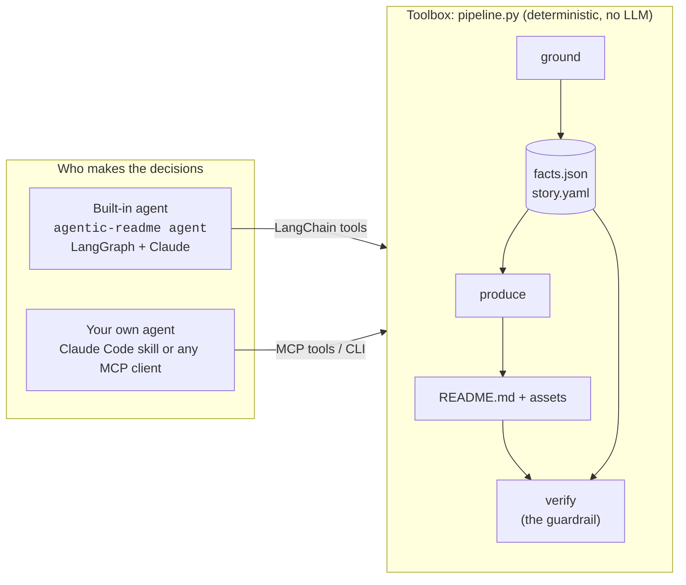
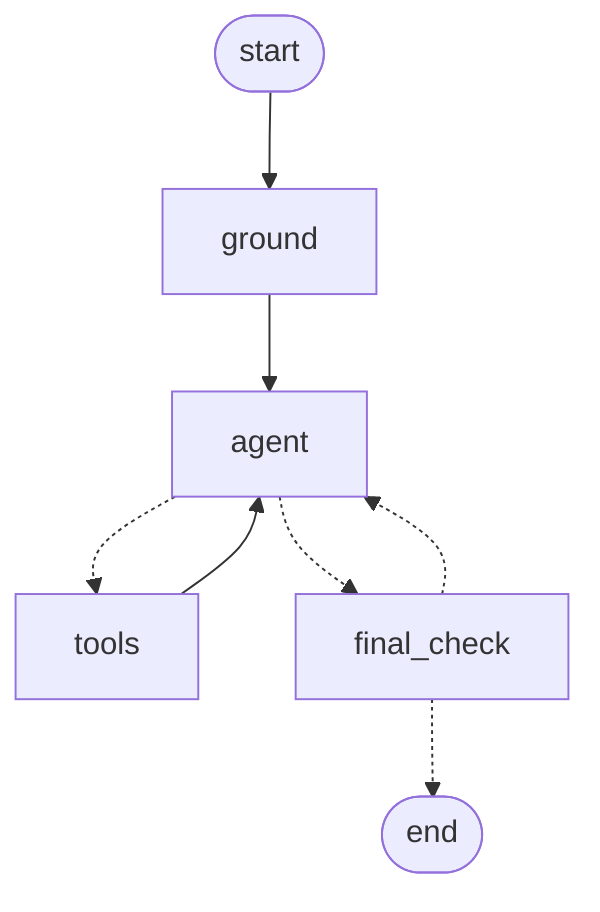

# Architecture

**In one sentence:** an LLM agent (LangGraph + Claude) writes the README's words, deterministic Python measures every number and checks the result, and the agent can't finish until that check passes.

New to the code? Read [CODE_TOUR.md](CODE_TOUR.md) next. It follows one run through every file.

---

## Two drivers, one toolbox, one guardrail



The work is split by what each part is good at:

| Job | Done by | Why |
| :--- | :--- | :--- |
| Count tests, read versions, license, entrypoints | code (`ground/`) | Numbers must be exact and repeatable |
| Decide what the project is for; write the hook, problem and solution | **the LLM** (`update_story`) | Judgment and wording |
| Fill the README template, draw diagrams, plan the video | code (`produce/`) | Same input, same output |
| Check every number, link and GitHub rendering rule | code (`verify/`) | A guardrail the model can't argue with |
| Fix findings that have no single right answer | **the LLM** (`edit_readme`) | Judgment |
| Approve the story before it's published | a human (`--review`) | Taste and accountability |

There are two drivers because the same toolbox works either way. The built-in agent runs inside this package. A Claude Code session using the [skill](../skills/agentic-readme/SKILL.md), or any [MCP](../integrations/mcp/README.md) client, is an agent too: it calls the same steps as tools.

---

## The agent graph (`src/agentic_readme/agent/graph.py`)

This diagram is LangGraph's own drawing of the compiled graph (`build_graph(...).get_graph().draw_mermaid()`), so it can't drift from the code:



| Node | Kind | What it does |
| :--- | :--- | :--- |
| `ground` | code | Runs `pipeline.ground`, then sends the agent its task: every fact it may use, plus the draft story. |
| `agent` | **LLM** | Reads the conversation, then either asks for tool calls or replies that it's done. |
| `tools` | code | Runs each requested tool and returns the result as a `ToolMessage`. A failing tool becomes an error message the model can read and recover from. |
| `final_check` | code | Runs `pipeline.verify`. Pass: end. Fail: the findings go back to the agent, at most `max_checks` times (default 3). |

The dashed arrows are decisions. After `agent`, the graph goes to `tools` if the model asked for any, otherwise to `final_check`. After `final_check`, it ends if verify passed or the retries are used up, otherwise it goes back to `agent`. The model can't skip `final_check`: it's an edge in the graph, not a tool the model may choose to call.

**State.** The state is `messages`, the conversation, which `add_messages` only ever appends to, plus `checks` and `passed`. A checkpointer (`InMemorySaver`) saves the state after every step. That's what makes the review pause possible.

**The agent's tools** (`agent/tools.py`):

| Tool | What it does | Guardrail |
| :--- | :--- | :--- |
| `list_files`, `read_file` | Explore the repo | Only paths inside the repo; files are capped at 20,000 characters |
| `update_story` | Rewrite `hook`, `problem`, `solution`, `target_audience` in `story.yaml` | Claims can't be edited, and any number not in `facts.json` is rejected |
| `produce_readme` | Rebuild the README and assets | With `--review`, pauses here until a human approves |
| `verify_readme` | Check and auto-fix; return each finding with its fix | — |
| `edit_readme` | Replace one exact, unique piece of README text | New numbers must be in `facts.json` |

**Model.** The default is `anthropic:claude-opus-5-5`, via LangChain's `init_chat_model`, so any `provider:model` string works (`--model` or `AGENTIC_README_MODEL`). For Claude it sets `effort="high"`, which suits multi-step tool use, and turns on Anthropic's server-side refusal fallback.

### Agent patterns in this graph

- **Tool calling.** The model doesn't run code. It returns `tool_calls`, and `run_tools` executes them.
- **ReAct loop.** `agent ⇄ tools` repeats until the model stops asking for tools.
- **Evaluator-optimizer, at two levels.** Inside `verify`, `check → auto_fix → check` fixes everything with one right answer, with no LLM. Around that, `final_check` grades the agent's work and sends the remaining findings back for the LLM to fix.
- **Guardrails in code, not in the prompt.** The prompt *asks* for numbers from `facts.json`; the tools *enforce* it.
- **Human-in-the-loop.** `interrupt()` pauses the graph mid-tool, the checkpointer keeps the state, and `Command(resume=answer)` continues with the human's reply. A "no" goes back to the agent as feedback.
- **Budgets.** `recursion_limit` (80 graph steps) and `max_checks` (3) stop a run that never converges.
- **Observability and evaluation.** With `LANGSMITH_TRACING=true`, LangSmith records every node, LLM call and tool call. `agentic-readme eval` runs the agent on every example as a LangSmith experiment, scored by deterministic graders (see [EVALUATION.md](EVALUATION.md)).

---

## The toolbox (`src/agentic_readme/pipeline.py`)

`pipeline.py` is one page with five functions: `ground`, `produce`, `check`, `verify`, `run`. Each calls one folder:

| Step | Module | Public function | Reads | Writes |
| :--- | :--- | :--- | :--- | :--- |
| ground | `ground/project.py` | `detect_project` | file layout | — |
| | `ground/facts.py` | `collect_facts` | config, code, tests; runs `pytest --collect-only` and `--help` | — |
| | `ground/story.py` | `build_story`, `refresh_story` | facts | — |
| | `pipeline.py` | `ground` | the above | `.agentic-readme/facts.json`, `story.yaml` |
| produce | `produce/readme.py` | `write_readme` | story, facts | `README.md` |
| | `produce/diagram.py` | `draw_diagrams` | story | `assets/diagrams/*` |
| | `produce/demo.py` | `make_demo` | story | `assets/demo/*` |
| | `produce/video.py` | `make_storyboard` | story, facts | `assets/video/brag_spec.json`, `scenes.md` |
| verify | `verify/claims.py` | `check_claims` | README, assets, facts | findings |
| | `verify/rendering.py` | `check_rendering` | README, assets | findings |
| | `verify/voice.py` | `check_voice` | README | findings |
| | `verify/fixer.py` | `auto_fix` | README, findings | `README.md` (fixed) |

All the house-style word lists and limits live in `rules.py`, and the data shapes in `models.py`. The two front doors, `cli.py` for people and CI and `mcp.py` for AI assistants, are thin wrappers over `pipeline.py`.

`tests/test_examples.py` regenerates each committed example and requires byte-identical output, so a change to any step shows up as a failing test.

---

## The contracts

Every step reads or writes these two files in `.agentic-readme/`.

**`facts.json`**: every number, with the file that proves it. Only `ground` writes it; no agent tool can.

```json
"test_count": { "value": 4, "source_file": "tests", "source_type": "source_code",
                "description": "Static test definition count (AST/regex collection fallback)" }
```

(From [`examples/csv-dedupe`](../examples/csv-dedupe/.agentic-readme/facts.json). `ground` asks `pytest --collect-only` first. When the tests can't be collected, it counts `def test_...` functions instead and records that it did.)

**`story.yaml`**: what the README says. The agent or a human may rewrite its words. Its claims come from facts, and re-running `ground` refreshes their numbers while keeping the words.

```yaml
hook: Your customer export lists Ana three times.
key_claims:
- claim: Automated test suite with 4 passing tests verifying core system invariants.
  evidence_file: tests
  metrics:
    test_count: 4
```

## Why the numbers never come from the LLM

A language model is good at saying what a project is for. It's unreliable at copying exact numbers, and a README that says "52 tests pass" when there are 44 does real damage. So the LLM never supplies a number. `ground` measures them, `produce` copies them, the agent's write tools reject new ones, and `verify` fails the run on any mismatch. The same audit runs in CI with no API key: `agentic-readme audit README.md --facts .agentic-readme/facts.json`.
