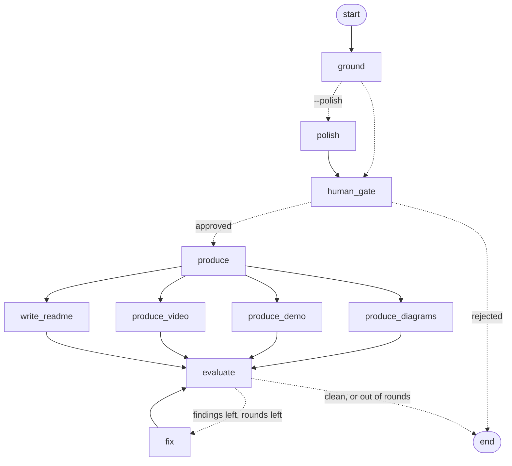

# LangGraph, LangChain, LangSmith, and Langfuse

Agentic ReadMe Creator is built on the LangChain ecosystem. Every run goes through it, whether it starts from the CLI, the MCP server, the Python API, or an agent:

| Layer | What it does here | Code |
| :--- | :--- | :--- |
| **LangGraph** | Runs the pipeline. Ground → human gate → four producers in parallel → evaluate ⇄ fix is a `StateGraph`, and `produce` and `verify` run on their own graphs. | [`orchestrate/graph.py`](../src/agentic_readme/orchestrate/graph.py) |
| **LangChain** | Exposes the pipeline as tools, runs a Claude agent over them, and provides the chain that rewrites the story's prose (`--polish`). | [`orchestrate/tools.py`](../src/agentic_readme/orchestrate/tools.py), [`story_chain.py`](../src/agentic_readme/orchestrate/story_chain.py), [`llm.py`](../src/agentic_readme/orchestrate/llm.py) |
| **LangSmith** | Traces every run, node, and step, and records evaluation experiments. | [`core/observability.py`](../src/agentic_readme/core/observability.py), [`orchestrate/evaluation.py`](../src/agentic_readme/orchestrate/evaluation.py) |
| **Langfuse** | Receives the same traces as LangSmith, and records the same evaluation experiments. | same files |

All four are installed with the package. Two things stay opt-in:

- **Model calls.** The default run makes none. Only `run --polish` and `agent` call Claude, and every number in the README still comes from `facts.json` and is audited.
- **Trace uploads.** LangSmith and Langfuse each switch on when their credentials are set. Without credentials, tracing makes no network calls and prints nothing. Secrets and your home directory are masked before anything is sent.

## Setup

```bash
pip install -e .
```

| Variable | Needed for | Default |
| :--- | :--- | :--- |
| `LANGSMITH_TRACING`, `LANGSMITH_API_KEY` | Tracing to LangSmith (set `LANGSMITH_TRACING=true`) | off |
| `LANGSMITH_PROJECT` | The LangSmith project traces go to | `agentic-readme` |
| `LANGSMITH_ENDPOINT` | EU or self-hosted LangSmith | LangSmith US |
| `LANGFUSE_PUBLIC_KEY`, `LANGFUSE_SECRET_KEY` | Tracing to Langfuse | off |
| `LANGFUSE_BASE_URL` | Your Langfuse region or self-hosted URL, e.g. `https://us.cloud.langfuse.com`, `https://jp.cloud.langfuse.com` | `https://cloud.langfuse.com` (EU) |
| `LANGFUSE_TRACING_ENVIRONMENT` | Separating `local`, `ci`, and production traces in Langfuse | `default` |
| `ANTHROPIC_API_KEY` | `run --polish` and `agent` (an `ant auth login` profile also works) | none |
| `AGENTIC_README_MODEL` | Choosing the Claude model | `claude-opus-5-5` |

Keep keys in your shell profile, a secret manager, or your CI's secret settings. Never commit them.

## LangGraph: the pipeline



```bash
agentic-readme run examples/tip-splitter        # the whole graph
agentic-readme run . --review                   # pause after grounding; edit story.yaml, then confirm
agentic-readme run . --polish                   # let Claude rewrite hook, problem, and solution first
agentic-readme produce .                        # just the four producers, in parallel
agentic-readme verify .                         # just evaluate ⇄ fix
```

How it works:

- **The four producers run in parallel.** Diagram, demo, video, and README only read the locked contracts, so they run in the same graph step, and `evaluate` waits for all four. Each adds its output paths to `state["assets"]`.
- **The human gate is `interrupt()`.** With `--review`, the run pauses after grounding and the `InMemorySaver` checkpointer saves its state. You edit `story.yaml`, answer the prompt, and the CLI resumes the graph with `Command(resume=True)`. The gate reads the contracts from disk at that moment, so your edits are what the producers use. Answering no ends the run before anything is written. Over MCP, `agentic_readme_run` with `auto_approve: false` stops at the gate in the same way.
- **evaluate ⇄ fix is the Evaluator-Optimizer loop.** Each visit is one pass, with the same stopping rule as before: stop when the README is clean, or after two rounds.
- **State is plain JSON:** paths, flags, the contracts as dicts, the report, and a `notes` list where each node appends a line.

From Python:

```python
from agentic_readme.core.runner import PipelineRunner

result = PipelineRunner(".").run_all(auto_approve_gate=False, approve=lambda payload: True)
print(result["passed"], result["notes"])
```

## LangChain: tools, an agent, and a checked chain

### Tools

`build_tools()` creates one `StructuredTool` per entry in the MCP server's tool list, and each runs through the same `execute_tool()`. MCP clients, OpenAI function calling, and LangChain agents therefore share each tool's name, schema, and code.

```python
from agentic_readme.orchestrate.tools import build_tools

audit = build_tools()[0]
print(audit.invoke({"readme_path": "README.md"}))
```

### Agent

```bash
agentic-readme agent "audit examples/tip-splitter/README.md"
agentic-readme agent "write and verify the README for examples/tip-splitter"
```

`build_agent()` is LangChain's `create_agent` with Claude and the five tools. The model is `claude-opus-5-5` with adaptive thinking at `medium` effort. The API's server-side refusal fallback is on, so a request the model declines is retried on a fallback model in the same call. Like `run`, the agent's `agentic_readme_run` tool **overwrites `README.md`** in the folder it is pointed at.

### Story polish chain

`run --polish` adds a `polish` node before the human gate:

```python
STORY_PROMPT | ChatAnthropic(...).with_structured_output(StoryProse, method="json_schema")
```

It rewrites only `hook`, `problem`, and `solution`. Claims, metrics, and quickstart commands stay as grounding wrote them. The rewrite is thrown away, and the run output says why, if:

- it contains a number that appears in neither `facts.json` nor the current draft,
- it uses a marketing word the Voice Editor flags (the list is in [`humanizer_rules.py`](../src/agentic_readme/rubrics/humanizer_rules.py)), or
- the model call fails (no credentials, a refusal, a network error).

Use `--review` together with `--polish` to read the rewrite before anything is produced.

## LangSmith and Langfuse: tracing

Set the credentials for either platform, or both, and run the pipeline:

```bash
export LANGSMITH_TRACING=true LANGSMITH_API_KEY=...
export LANGFUSE_PUBLIC_KEY=pk-lf-... LANGFUSE_SECRET_KEY=sk-lf-... LANGFUSE_BASE_URL=https://cloud.langfuse.com
agentic-readme run examples/tip-splitter
```

Each operation is one trace with a descriptive name: `readme-pipeline` (`run`), `readme-produce`, `readme-verify`, and `readme-agent`. Both platforms show the same tree:

```
readme-pipeline                    chain       input: repo, options · output: verdict, findings, steps · scores
└── pipeline-graph                 chain       the LangGraph run
    ├── ground                     chain
    │   └── ground_contracts       retriever   reads facts from the repo: tests, config, CLI help
    ├── route_after_ground                     which branch the graph took
    ├── polish → polish_story      chain       (with --polish)
    │   └── ChatAnthropic          generation  model, tokens, cost
    ├── human_gate
    ├── produce
    ├── produce_diagrams │ produce_demo │ produce_video │ write_readme     (parallel)
    └── evaluate
        └── evaluate_readme        evaluator   input: the README text and story · output: the report
        (fix → apply_fixes          tool        when a round finds drift)
```

What each trace carries:

- **An explicit input and output.** The root's input is the repository and the run options; its output is a summary (passed, rounds, findings, steps), not the whole graph state.
- **Specific observation types.** Grounding is a `retriever`, the verifier is an `evaluator`, the auto-fixer is a `tool`, and the Claude call is a `generation` with its model name and token usage, so Langfuse can compute cost. In `agent` runs, LangChain's agent shows up as an `agent` with its tool calls nested under it.
- **Scores.** `verification_passed` (1 or 0) and `fatal_findings` are attached to every `readme-pipeline` and `readme-verify` trace: as scores in Langfuse and as feedback in LangSmith. You can filter and chart runs by them.
- **Tags, metadata, and release.** Tags name the operation (`pipeline`, `produce`, `verify`, `agent`), metadata holds the repo name and options, and the package version is set as the Langfuse release and as `app_version` metadata. Set `LANGFUSE_TRACING_ENVIRONMENT` (for example `ci` or `local`) to keep environments apart.
- **One trace per `--review` run.** The pause and the resume are two graph invocations under the same root, so the whole run, including the human decision, reads as one trace.
- **Masking.** Before anything leaves the process, both platforms run it through `mask_secrets`. It replaces credentials in URLs (`https://user:token@…`), API keys (`sk-ant-`, `sk-lf-`, `pk-lf-`, `lsv2_`, GitHub and Slack tokens), and your home directory (`~`). Repository paths, git remotes, CLI output, and README text all pass through it.

How it's wired (in [`core/observability.py`](../src/agentic_readme/core/observability.py)):

- **`trace_run(name, inputs=...)`** opens the trace. For Langfuse, it calls `propagate_attributes` (trace name, tags, metadata, version) first, then opens the root observation, then adds a LangChain `CallbackHandler`. For LangSmith, it opens a root run whose client masks inputs and outputs. It returns the config that LangGraph and LangChain runs nest under, plus `set_output` and `score`.
- **`@traced(name, as_type=..., inputs=...)`** records plain Python steps with a chosen Langfuse type and an explicit input.
- **Flushing.** The CLI flushes both platforms before it exits. An unreachable backend logs upload errors to stderr, but it never changes the README or the exit code.

## LangSmith and Langfuse: evaluation

```bash
agentic-readme eval                 # local: runs the pipeline on each example and prints the scores
agentic-readme eval --langsmith     # records a LangSmith experiment
agentic-readme eval --langfuse      # records a Langfuse experiment
```

- **Dataset** `agentic-readme-examples` is created on first use. It has one row per `examples/<name>/` with a committed `facts.json`. The input is the folder name, and the expected output is the committed test count.
- **Target** runs the pipeline on a temporary copy of the example, so the committed files are never changed.
- **Evaluators** (shared by all three runners): `verification_passed` (no fatal findings), `first_pass_clean` (no auto-fixes needed), and `test_count_matches` (grounding finds the committed test count). Langfuse records each as a 0 or 1 score.

Local output from this repo:

```
┃ Example      ┃ verification_passed ┃ first_pass_clean ┃ test_count_matches ┃
│ csv-dedupe   │ pass                │ pass             │ pass               │
│ habit-streak │ pass                │ pass             │ pass               │
│ tip-splitter │ pass                │ pass             │ pass               │
```
