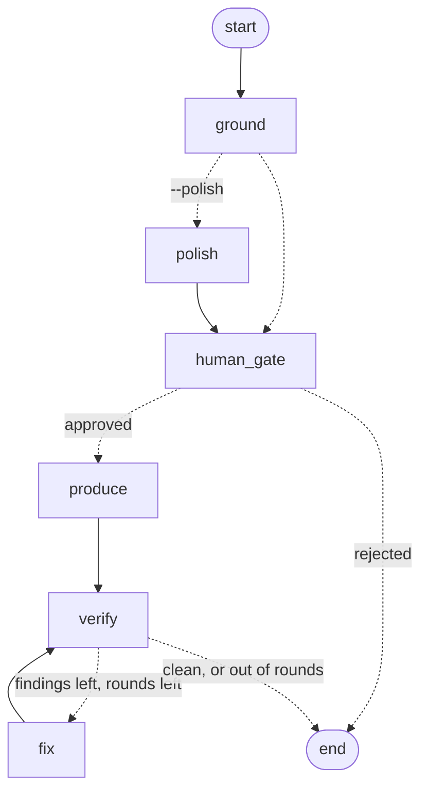

# LangChain, LangGraph, and LangSmith

The core pipeline is plain Python and doesn't need any of this. The optional `[langchain]` extra adds a second way to run it, built on three libraries:

| Library | What it does here | Code |
| :--- | :--- | :--- |
| **LangGraph** | Runs Ground → Produce → Verify as a state graph. The human gate pauses the run while you edit `story.yaml`, and verify ⇄ fix is a loop in the graph. | [`orchestrate/graph.py`](../src/agentic_readme/orchestrate/graph.py) |
| **LangChain** | Turns the five pipeline tools into LangChain tools, adds a Claude agent that calls them, and provides an optional chain that rewrites the story's prose. | [`orchestrate/tools.py`](../src/agentic_readme/orchestrate/tools.py), [`story_chain.py`](../src/agentic_readme/orchestrate/story_chain.py), [`llm.py`](../src/agentic_readme/orchestrate/llm.py) |
| **LangSmith** | Traces each graph run, node, and pipeline phase, and scores the graph against the committed examples. | [`core/tracing.py`](../src/agentic_readme/core/tracing.py), [`orchestrate/evaluation.py`](../src/agentic_readme/orchestrate/evaluation.py) |

Nothing changes for the default path. `run`, `graph` without `--polish`, and `eval` make no model calls, and every number in the README still comes from `facts.json` and is audited.

## Install

```bash
pip install -e ".[langchain]"
```

`pip install -e ".[dev]"` includes it, so the full test suite runs.

## Environment variables

| Variable | Needed for | Default |
| :--- | :--- | :--- |
| `ANTHROPIC_API_KEY` | `graph --polish` and `agent` (an `ant auth login` profile also works) | none |
| `AGENTIC_README_MODEL` | Choosing the Claude model | `claude-opus-5-5` |
| `LANGSMITH_TRACING` | Set to `true` to send traces | off |
| `LANGSMITH_API_KEY` | Tracing and `eval --langsmith` | none |
| `LANGSMITH_PROJECT` | The LangSmith project traces go to | `agentic-readme` |
| `LANGSMITH_ENDPOINT` | EU or self-hosted LangSmith | LangSmith US |

## LangGraph: the pipeline as a graph



```bash
agentic-readme graph examples/tip-splitter      # same result as `run`, as a graph
agentic-readme graph . --review                 # pause after grounding; edit story.yaml, then confirm
agentic-readme graph . --polish                 # let Claude rewrite hook, problem, and solution first
```

How it works:

- **State holds plain values** (`ReadmeState`: paths, flags, the round number, the verification report as a dict). Each node reads `story.yaml` and `facts.json` from disk, so whatever is in those files when a node runs is what it uses.
- **The human gate is `interrupt()`.** With `--review`, the `human_gate` node pauses the run and the graph's `InMemorySaver` checkpointer saves its state. You edit `story.yaml`, answer the prompt, and the CLI continues with `Command(resume=True)`. `produce` then builds from your edited file. Answering no ends the run before anything is written.
- **verify ⇄ fix is the Evaluator-Optimizer loop**, with one pass per node visit and the same stopping rule as `EvaluatorOptimizer.run_loop` (clean, or two rounds).

From Python:

```python
from agentic_readme.orchestrate.graph import run_graph

state = run_graph("examples/tip-splitter", review=True, approve=lambda payload: True)
print(state["passed"], state["notes"])
```

## LangChain: tools, an agent, and a checked chain

### Tools

`build_tools()` creates one `StructuredTool` per entry in the MCP server's tool list and runs it through the same `execute_tool()`. MCP clients, OpenAI function calling, and LangChain agents therefore share each tool's name, schema, and code.

```python
from agentic_readme.orchestrate.tools import build_tools

audit = build_tools()[0]
print(audit.invoke({"readme_path": "README.md"}))
```

### Agent

```bash
agentic-readme agent "audit examples/tip-splitter/README.md"
agentic-readme agent "write and verify the README for examples/tip-splitter"
```

`build_agent()` is LangChain's `create_agent` with Claude and the five tools. The model is `claude-opus-5-5` with adaptive thinking at `medium` effort. It also turns on the API's server-side refusal fallback, so a request the model declines is retried on a fallback model in the same call. Like `run`, the agent's `agentic_readme_run` tool **overwrites `README.md`** in the folder it is pointed at.

### Story polish chain

`--polish` runs this chain on `story.yaml` before the human gate:

```python
STORY_PROMPT | ChatAnthropic(...).with_structured_output(StoryProse, method="json_schema")
```

It rewrites only `hook`, `problem`, and `solution`. Claims, metrics, and quickstart commands are left as grounding wrote them. The rewrite is thrown away, and the note in the run output says why, if:

- it contains a number that appears in neither `facts.json` nor the current draft,
- it uses a word the Voice Editor flags (`revolutionary`, `seamless`, and the rest of [`humanizer_rules.py`](../src/agentic_readme/rubrics/humanizer_rules.py)), or
- the model call fails (no credentials, a refusal, a network error).

The verify phase then audits the README built from the polished story, the same as any other.

## LangSmith: tracing and evaluation

### Tracing

```bash
export LANGSMITH_TRACING=true
export LANGSMITH_API_KEY=...
agentic-readme graph examples/tip-splitter
```

Each run shows up in the `agentic-readme` project as one trace:

```
agentic-readme                 graph run (tags: agentic-readme, langgraph; metadata: repo, polish, review)
├── ground       → phase_0_ground
├── polish       → polish_story → prompt, ChatAnthropic      (with --polish)
├── human_gate
├── produce      → phase_1_produce
└── verify       → evaluate      (then fix → apply_fixes, if needed)
```

The pipeline phases use `@traceable`, so the plain `run` command is traced too. With tracing off, or without the `langsmith` package, the decorator does nothing.

### Evaluation

```bash
agentic-readme eval                 # local: runs the graph on each example and prints the scores
agentic-readme eval --langsmith     # uploads the dataset and records a LangSmith experiment
```

- **Dataset** `agentic-readme-examples`: one row per `examples/<name>/` with a committed `facts.json`. The input is the folder name, and the reference output is the committed test count.
- **Target**: runs the graph on a temporary copy of the example, so the committed files are never changed.
- **Evaluators**: `verification_passed` (no fatal findings), `first_pass_clean` (no auto-fixes needed), and `test_count_matches` (grounding finds the committed test count).

Local output from this repo:

```
┃ Example      ┃ verification_passed ┃ first_pass_clean ┃ test_count_matches ┃
│ csv-dedupe   │ pass                │ pass             │ pass               │
│ habit-streak │ pass                │ pass             │ pass               │
│ tip-splitter │ pass                │ pass             │ pass               │
```
